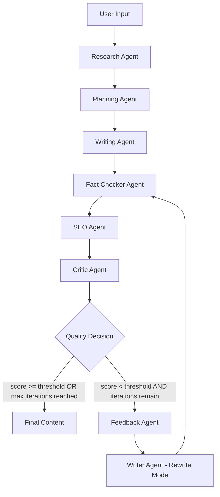

# Multi-Agent AI Content Creation & Verification Pipeline

A production-structured, closed-loop multi-agent system that researches, plans,
writes, fact-checks, SEO-evaluates, critiques, and **iteratively revises**
content until it meets a configurable quality bar — built with LangGraph,
LangChain, Pydantic, FastAPI, and Streamlit.

This is not a linear chain of LLM calls. It is a graph with real branching,
a bounded feedback loop, and structured (Pydantic-validated) communication
between independently-testable agents.

---

## 1. Problem Statement

Single-pass LLM content generation is unreliable: it hallucinates facts,
ignores requirements, and produces inconsistent quality with no mechanism
to catch or fix its own mistakes. Simply chaining "generate → done" doesn't
solve this.

## 2. Motivation

This project demonstrates what *agentic* AI actually looks like in
practice: specialized agents with narrow responsibilities, structured
outputs instead of free text, an evaluator that scores the work, a
feedback translator that turns scores into actionable instructions, and a
writer that revises based on that feedback — looping until quality is
acceptable or a hard iteration cap is hit.

## 3. Features

- 7 specialized agents, each with a single responsibility and a Pydantic-validated I/O contract
- A real closed feedback loop: **Critic score too low → Feedback → Writer revises → re-evaluate**
- Hard-bounded iterations (`MAX_ITERATIONS`) — no infinite loops, ever
- Pluggable research layer (`mock` / `web` / `local`, vector-store-optional)
- Full observability: per-agent timing, structured logs, revision history
- FastAPI backend + Streamlit dashboard, both hitting the same graph
- Offline **mock mode** — the entire architecture runs and is demoable with zero API key/cost
- Baseline-vs-agentic evaluation harness that measures the feedback loop's actual value
- Unit tests for schemas, agents, quality-decision logic, and the full graph

## 4. Architecture



State flows through a single strongly-typed `PipelineState` (see
`app/graph/state.py`); every node reads what it needs and returns a
partial update that LangGraph merges in. Run `python main.py` or hit
`GET /graph` to print/inspect the live compiled graph structure.

## 5. Agent Descriptions

| Agent | Input | Output | Responsibility |
|---|---|---|---|
| **Research** | topic, requirements | `ResearchResult` | Gather evidence via a `ResearchProvider`, extract facts/claims/uncertainties. Never writes prose. |
| **Planning** | `ResearchResult` | `ContentPlan` | Section structure, evidence-to-section mapping, per-section word budget. |
| **Writer** | plan + research (draft mode) or prior draft + feedback (rewrite mode) | `DraftContent` | Generates or revises the article. Rewrite mode edits the existing draft rather than starting over. |
| **Fact Checker** | draft + research | `FactCheckResult` | Extracts claims, checks each against evidence, flags unsupported/hallucinated/contradicted claims. |
| **SEO** | draft | `SEOResult` | Scores title/headings/keywords/readability/structure. Critiques only — never rewrites. |
| **Critic** | draft + all evaluations | `CriticResult` | The most important evaluator: 8-dimension scoring + `overall_score`, which the graph's decision node acts on. |
| **Feedback** | Critic + FactChecker + SEO results | `FeedbackResult` | Converts raw scores into a prioritized, actionable revision plan (critical fixes before cosmetic ones). |

## 6. Feedback Loop Explanation

After the Critic scores a draft, `quality_decision()` (`app/graph/nodes.py`)
makes a deterministic call:

```python
if overall_score >= quality_threshold:
    return "final"
if iteration_count >= max_iterations:
    return "final"          # bounded — never loops forever
return "feedback"
```

If routed to `feedback`, the Feedback Agent turns the Critic/FactChecker/SEO
output into a prioritized instruction list, the Writer Agent revises the
**existing** draft (not a fresh one) against that instruction list, and the
new draft goes back through Fact Check → SEO → Critic. Every cycle is
recorded in `revision_history`, so you can watch the score climb:

```
Version 1  Score: 62
Version 2  Score: 74
Version 3  Score: 86   <- FINAL (threshold: 80)
```

## 7. Technology Stack

Python 3.11+, LangGraph, LangChain, OpenAI-compatible LLM API, Pydantic v2,
FastAPI, Streamlit, httpx, python-dotenv, pytest, FAISS/ChromaDB (optional,
for a future vector-backed research provider).

## 8. Installation

```bash
git clone <this-repo>
cd multi_agent_content_pipeline
python -m venv .venv && source .venv/bin/activate   # or your preferred env tool
pip install -r requirements.txt
```

## 9. Environment Configuration

```bash
cp .env.example .env
# then edit .env and set at minimum:
#   OPENAI_API_KEY=sk-...
```

Key variables (all in `app/config.py`, nowhere else):

| Variable | Default | Purpose |
|---|---|---|
| `OPENAI_API_KEY` | — | Required for real (non-mock) runs |
| `MODEL_NAME` | `gpt-4o-mini` | Any OpenAI-compatible chat model |
| `MAX_ITERATIONS` | `3` | Hard cap on revision cycles |
| `QUALITY_THRESHOLD` | `80` | Critic `overall_score` needed to finalize |
| `RESEARCH_PROVIDER` | `mock` | `mock` \| `web` \| `local` |

No API keys are ever hard-coded; everything is read from `.env` via
`app/config.py`.

## 10. Running the Application

**No API key yet / just want to see it work end-to-end?** Everything below
supports a `--mock` / "offline mode" path that runs the real graph with a
deterministic mock LLM — good for a first smoke test.

```bash
# CLI
python main.py --topic "Federated Learning in Healthcare" --word-count 1500
python main.py --mock                     # fully offline, no API key needed

# FastAPI
uvicorn api.main:app --reload
# then POST to http://localhost:8000/generate

# Streamlit dashboard
streamlit run ui/streamlit_app.py
```

## 11. API Usage

```bash
curl -X POST http://localhost:8000/generate \
  -H "Content-Type: application/json" \
  -d '{
        "topic": "Federated Learning in Healthcare",
        "content_type": "Blog",
        "target_audience": "beginner-friendly",
        "tone": "professional",
        "word_count": 1500,
        "keywords": ["federated learning", "healthcare AI"],
        "include_references": true,
        "max_iterations": 3,
        "quality_threshold": 80
      }'
```

Returns a `FinalResult`: final content, quality scores, full revision
history, iteration count, execution time, and any warnings.

`GET /graph` returns the compiled graph as Mermaid text. `GET /health` is
a liveness probe.

## 12. Dashboard Usage

Open the Streamlit sidebar, fill in topic/content type/audience/tone/word
count/keywords/iteration cap/quality threshold, toggle **offline mock
mode** if you don't have an API key handy, and click **Run Pipeline**. The
dashboard shows: workflow step checklist, final content, the 8-dimension
quality scorecard, a revision-history line chart + table, and an
expandable feedback log per revision.

## 13. Example Workflow

```
Topic: "Federated Learning in Healthcare"
Requirements: Article, 1500 words, professional tone, beginner-friendly,
              include references, SEO optimized

[Research]    Started -> Completed (2.1s)
[Planning]    Started -> Completed (1.4s)
[Writer]      Draft v1 generated -> Completed (5.8s)
[FactChecker] 14/18 claims supported
[SEO]         Score: 68
[Critic]      Overall Score: 62
[Feedback]    5 issues identified
[Writer]      Revision 1 -> Completed
[FactChecker] 17/18 claims supported
[SEO]         Score: 81
[Critic]      Overall Score: 86
[Decision]    Quality threshold reached
[Pipeline]    Completed
```

## 14. Evaluation Methodology

`app/evaluation/metrics.py` extracts quantitative signals (overall/factuality/
readability/SEO scores, iterations, execution time, word count) from every
completed run. `app/evaluation/experiments.py` runs the **same topic**
through two modes:

- **Baseline** — Research → Planning → Writer → single evaluation pass, never revised.
- **Agentic** — the full closed-loop pipeline.

and aggregates results across topics — actual execution only, nothing fabricated.

## 15. Baseline vs. Feedback-Loop Experiment

```bash
python experiments/run_evaluation.py                 # real LLM, uses .env
python experiments/run_evaluation.py --mock           # offline demo
python experiments/run_evaluation.py --topics "Topic A" "Topic B"
```

Example output shape:

```
Baseline quality: 68.4
Feedback pipeline: 82.7
Improvement: 20.9%
```

A JSON report is written to `experiments/results.json`.

## 16. Project Structure

```
multi_agent_content_pipeline/
├── app/
│   ├── agents/            # research, planning, writer, fact_checker, seo, critic, feedback
│   ├── graph/              # state.py, nodes.py, workflow.py (LangGraph wiring)
│   ├── models/schemas.py   # every Pydantic contract in the system
│   ├── research/            # base.py + mock/web/local providers + factory
│   ├── evaluation/           # metrics.py, experiments.py
│   ├── llm/client.py          # structured-output LLM client (+ MockLLMClient)
│   ├── config.py
│   └── logging_config.py
├── api/main.py              # FastAPI app
├── ui/streamlit_app.py       # Streamlit dashboard
├── experiments/run_evaluation.py
├── tests/                     # schemas, agents, workflow, feedback-loop tests
├── main.py                    # CLI entrypoint
├── requirements.txt
├── .env.example
└── pytest.ini
```

## 17. Testing

```bash
pytest
```

Covers: every Pydantic schema; every agent in isolation via `MockLLMClient`
(including malformed-JSON retry behavior); the quality-decision function
directly; and full-graph execution end-to-end for all four required
scenarios:

1. Score below threshold → revision occurs
2. Score above threshold → final output, no revision
3. Maximum iterations reached → pipeline terminates (with warning), even below threshold
4. Invalid/malformed LLM response → retry, then a controlled `LLMError` if still unparseable

> **Note on this environment:** this project was authored in a sandbox
> without outbound network access, so `pip install -r requirements.txt`
> and `pytest` could not be executed live here. All modules were
> individually syntax-checked (`py_compile`), and the mock-driven tests
> were designed to exercise the exact call sequence the real graph makes.
> Please run `pip install -r requirements.txt && pytest` locally as the
> first step — if anything surfaces, it'll most likely be a minor
> LangGraph/Pydantic version-API mismatch, not a structural issue.

## 18. Limitations

- The `WebResearchProvider` targets a Tavily-shaped API by default; swap the endpoint/payload if you use a different search vendor.
- `LocalDocumentProvider` uses keyword overlap, not embeddings — fine for small local corpora, not a real retrieval system.
- No persistent memory yet (by design — see below).
- Critic/Fact-Checker scoring quality is only as good as the underlying LLM; this architecture bounds *process* risk (unbounded loops, unstructured hand-offs) but doesn't eliminate model error.
- Token usage / cost tracking in `evaluation/metrics.py` is wired up but populated only if you extend `LLMClient` to surface usage metadata from your provider's response.

## 19. Future Improvements / Phase 2+ (not implemented)

**Phase 2 — Persistent Agent Memory.** `BaseAgent` (`app/agents/base.py`)
has a clear injection point for a `self.memory` object; the natural shape
is a store keyed by topic/domain holding prior feedback and accepted
revisions, consulted by Planning/Writer at prompt-construction time.

**Phase 3 — Learning from Feedback.** Persist every `RevisionRecord`
(already fully structured) to a database, then mine recurring
`critical_issues` / `weaknesses` patterns across runs to pre-emptively
steer the Writer and tighten the Critic's rubric over time.

**Phase 4 — Additional Agents.** The graph is a `StateGraph` with named
nodes and explicit edges — plagiarism detection, citation verification,
style-transfer, social-media adaptation, translation, image generation, or
a human-approval gate can each be added as a new node + edge without
restructuring existing agents.
